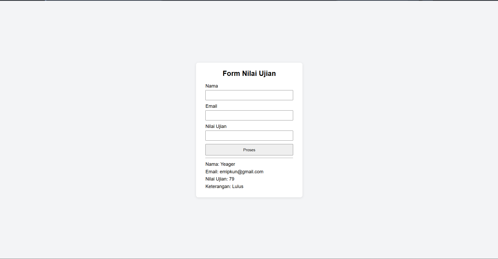

# Tugas PHP: Struktur Kendali & Form

Tugas ini mengimplementasikan materi **Struktur Kendali dan Percabangan** serta **Form Processing** pada PHP.

## Deskripsi

Aplikasi web sederhana berisi form dengan tiga input:

1. Nama
2. Email
3. Nilai Ujian

Setelah form dikirim, program menentukan keterangan berdasarkan nilai ujian:

| Kondisi | Keterangan |
|---------|------------|
| Nilai > 70 | Lulus |
| Nilai <= 70 | Remedial |

Hasil (nama, email, nilai, dan keterangan) ditampilkan di halaman browser yang sama, di bawah form.

## Contoh Output

**Remedial**

**Lulus**

## Catatan

Nilai tepat 70 dikategorikan **Remedial**, sesuai kondisi `nilai > 70` untuk Lulus.